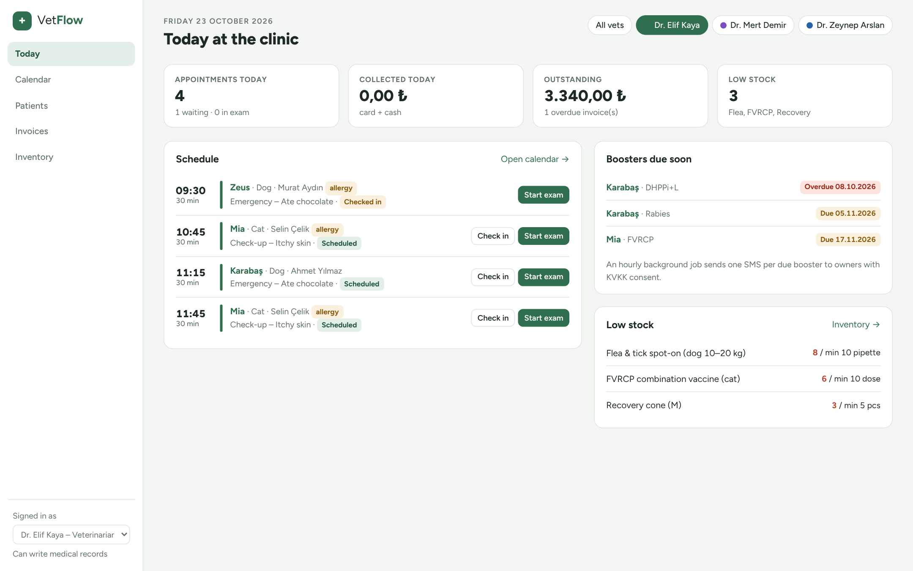
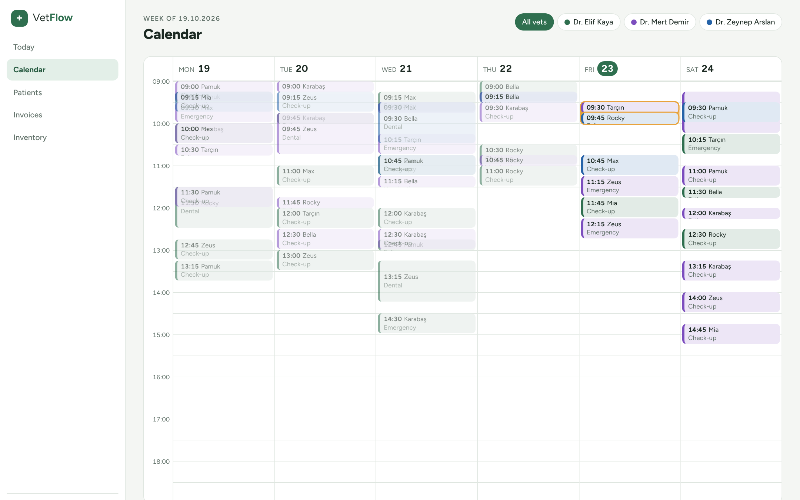
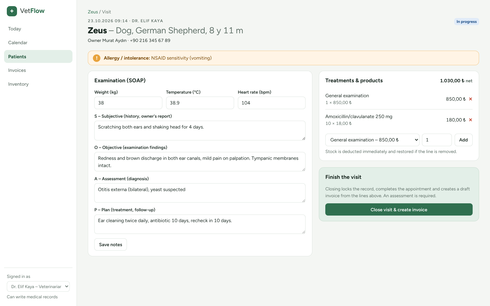
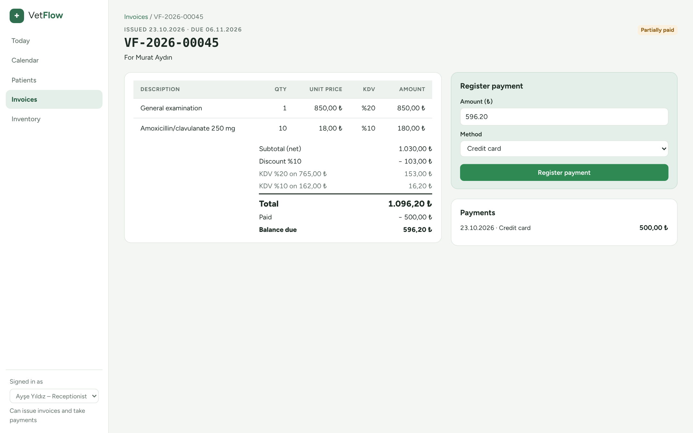
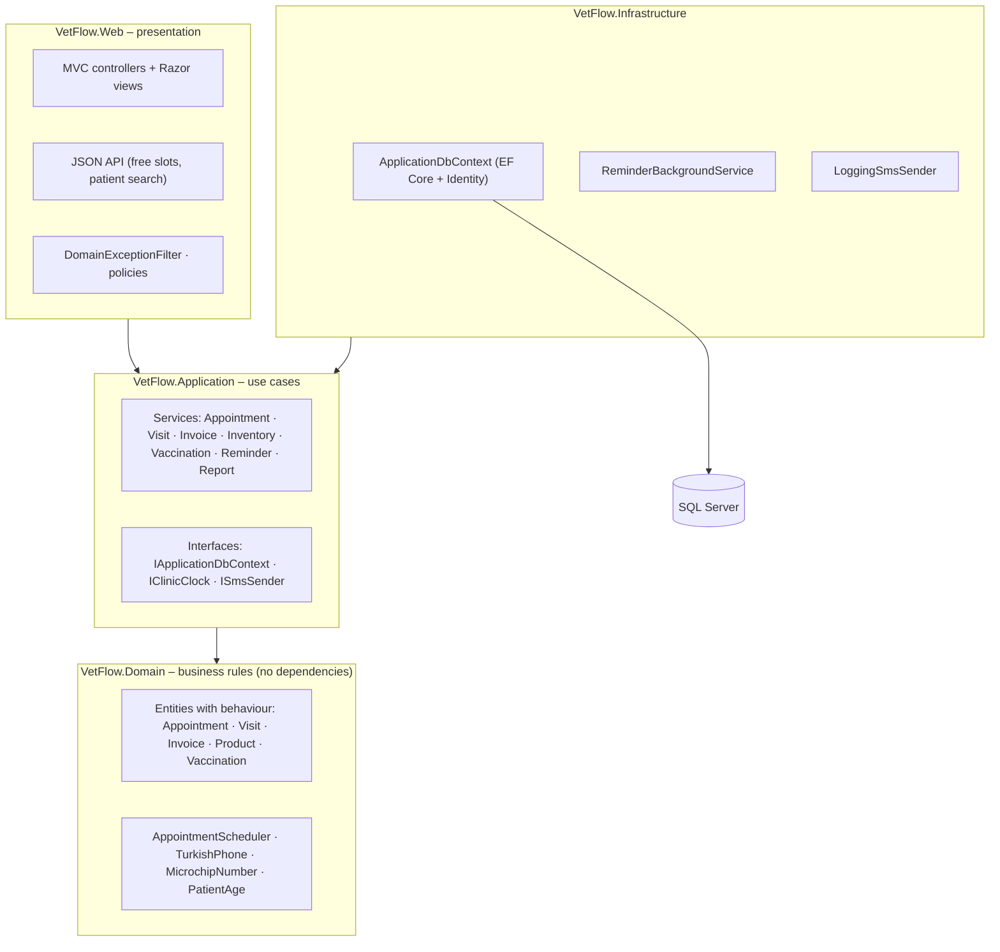

# VetFlow – Veterinary Clinic Management


**VetFlow** is a full-stack **ASP.NET Core MVC** application that runs the daily work of a small-animal veterinary
clinic: booking appointments, writing medical records, tracking vaccinations, managing stock and invoicing –
built with **Clean Architecture**, **Entity Framework Core** and **SQL Server**.

### [▶ Open the live demo](https://alicavuss.github.io/VetFlow/) &nbsp;·&nbsp; [Demo accounts](#demo-accounts) &nbsp;·&nbsp; [5-minute code tour](#5-minute-code-tour)

> The **live demo** opens instantly in any browser: it reproduces the main screens and business rules with sample data
> (try *Start exam → close visit → issue invoice → take a payment*). The **full application** (ASP.NET Core + SQL Server)
> is this repository – `docker compose up` or `dotnet run`.

| Today – schedule, waiting room, alerts | Week calendar per veterinarian |
|---|---|
|  |  |
| **Medical record (SOAP) with allergy warning** | **Invoice with KDV breakdown, discount and partial payment** |
|  |  |

## At a glance

- **Stack:** C# · .NET 10 · ASP.NET Core MVC · Entity Framework Core 10 · SQL Server · ASP.NET Core Identity · Bootstrap 5 · Chart.js · xUnit · Docker
- **Demonstrates:** Clean Architecture (Domain / Application / Infrastructure / Web), rich domain model, scheduling rules with conflict detection,
  money handling with `decimal` and VAT per rate, idempotent background job (outbox pattern), role-based authorization, JSON endpoints used from JavaScript,
  unit + service tests, containerisation.
- **Local details:** Turkish phone numbers (E.164), KDV rates, KVKK consent for SMS, ISO 11784 microchips, Europe/Istanbul clinic time.

## 5-minute code tour

| What to look at | Where |
|---|---|
| Booking rules: opening hours, Sundays, past, double-booking, free slots | [`AppointmentScheduler.cs`](src/VetFlow.Domain/Services/AppointmentScheduler.cs) |
| Invoice: lines, discount, VAT per rate, issue, partial payments | [`Invoice.cs`](src/VetFlow.Domain/Entities/Invoice.cs) |
| Visit → stock deduction → close → draft invoice | [`VisitService.cs`](src/VetFlow.Application/Services/VisitService.cs) |
| Reminder job with de-duplication (outbox) | [`ReminderService.cs`](src/VetFlow.Application/Services/ReminderService.cs) · [`ReminderBackgroundService.cs`](src/VetFlow.Infrastructure/BackgroundJobs/ReminderBackgroundService.cs) |
| Persistence abstraction (Clean Architecture boundary) | [`Abstractions.cs`](src/VetFlow.Application/Interfaces/Abstractions.cs) · [`ApplicationDbContext.cs`](src/VetFlow.Infrastructure/Data/ApplicationDbContext.cs) |
| EF Core mapping (precision, filtered unique indexes, conversions) | [`EntityConfigurations.cs`](src/VetFlow.Infrastructure/Data/Configurations/EntityConfigurations.cs) |
| Week calendar view + booking form with live free slots | [`Appointments/Index.cshtml`](src/VetFlow.Web/Views/Appointments/Index.cshtml) · [`appointment-form.js`](src/VetFlow.Web/wwwroot/js/appointment-form.js) |
| Composition root: Identity, policies, filters | [`Program.cs`](src/VetFlow.Web/Program.cs) |
| Tests | [`tests/VetFlow.Tests`](tests/VetFlow.Tests) |

---

## What the clinic can do with it

| Module | Highlights |
|--------|-----------|
| **Today dashboard** | Today's schedule per veterinarian with one-click *Check in → Start exam*, waiting room, payments of the last 30 days (Chart.js), outstanding balance, overdue invoices, boosters due and low-stock alerts. |
| **Calendar** | Week view (Mon–Sat) with colour per veterinarian; click an empty slot to book. Booking form with patient autocomplete, default duration per appointment type and a **free-slot picker** (JSON API). |
| **Scheduling rules** | Opening hours 09:00–19:00, closed on Sundays, no bookings in the past, **no double-booking** of a veterinarian or a patient – enforced by a pure, unit-tested domain service. |
| **Patients & owners** | Owner with Turkish phone validation (normalised to E.164) and **KVKK SMS consent**; patients with species, breed, age, sex/neutered, **ISO 11784 microchip** (15 digits, unique), weight history chart and **allergy warning on every clinical screen**. |
| **Medical records (SOAP)** | Visits with vitals and *Subjective / Objective / Assessment / Plan* notes. Services and products used are added to the visit and **deducted from stock immediately**. Closing requires a diagnosis, completes the appointment and creates a **draft invoice** automatically. |
| **Vaccinations** | Vaccine protocol per species with booster interval; next due date is calculated; *due soon / overdue* list based on the **latest** vaccination per patient and vaccine. |
| **SMS reminders** | Hourly `BackgroundService` queues reminders for boosters due within 7 days and tomorrow's appointments – only for consenting owners, **once per event** (outbox table with a unique de-duplication key), with retry of failed sends. |
| **Inventory** | Price list (net price + **KDV 1 % / 10 % / 20 %**), stock levels, reorder level, goods received, stock-take corrections and a full **stock movement ledger**. |
| **Invoicing** | Draft → Issued → Partially paid → Paid. Lines from visits or counter sales, discount (max 50 %), **VAT breakdown per rate**, sequential numbers per year (`VF-2026-00042`), 14-day payment term, overdue detection, partial payments (cash / card / transfer) and a **print / PDF view**. |
| **Reports** | Collected per month (12 months), sales by category, top services & products, appointments per type and **no-show rate**. |
| **Security** | ASP.NET Core Identity, authenticated-by-default, role-based policies: **Admin**, **Veterinarian** (clinical), **Receptionist** (billing). |

## Tech stack

- **C# 14 / .NET 10**, ASP.NET Core **MVC** (Razor views, Tag Helpers), minimal JSON API controllers
- **Entity Framework Core 10** + **SQL Server** (Fluent API, value conversions, precision, filtered unique indexes, split queries, connection resiliency)
- **ASP.NET Core Identity** with roles and policies
- `BackgroundService` + `PeriodicTimer` for scheduled jobs, `TimeProvider` / clinic clock for testable time
- Bootstrap 5.3 with a custom theme, Bootstrap Icons, Chart.js, vanilla JavaScript (`fetch`)
- **xUnit** (domain rules + application services on the EF Core in-memory provider)
- Docker / docker-compose

## Architecture



Dependencies point inwards: the **Domain** knows nothing about EF Core or ASP.NET; the **Application** layer depends
only on abstractions (`IApplicationDbContext`, `IClinicClock`, `ISmsSender`) that **Infrastructure** implements.

```
src/
├── VetFlow.Domain           # Entities, enums, value objects, AppointmentScheduler – pure C#
├── VetFlow.Application      # Use-case services, DTOs, interfaces, PagedResult, Money formatting
├── VetFlow.Infrastructure   # EF Core DbContext + configurations, Identity, seeding, clinic clock, SMS, background job
└── VetFlow.Web              # Controllers, view models, Razor views, filters, wwwroot
tests/
└── VetFlow.Tests            # xUnit: domain rules + services (EF Core InMemory)
```

### Design decisions worth talking about

- **Rich domain model.** State changes go through methods with guard clauses – `Appointment.CheckIn/Start/Complete/Cancel/MarkNoShow`,
  `Visit.AddItem/Close`, `Invoice.AddLine/Issue/RegisterPayment/Cancel`, `Product.RemoveStock/AdjustTo` – and setters are private
  where it matters, so invalid transitions are impossible from any controller.
- **Snapshotting.** Visit items and invoice lines copy price and VAT at the moment of use, so later price changes never alter history.
- **Money is `decimal`** with explicit SQL precision, away-from-zero rounding per line, VAT computed after discount and broken down per rate.
- **Clinic time ≠ server time.** `IClinicClock` converts to `Europe/Istanbul`, so the app behaves correctly in a UTC container.
- **Idempotent background job.** Reminders use an outbox table with a unique `DedupKey` – running the job twice never sends twice.
- **Thin controllers.** Business errors (`DomainException`) are mapped centrally by an exception filter to a flash message (MVC) or
  `ProblemDetails` (API); `NotFoundException` becomes a 404.
- **Efficient reads.** `AsNoTracking`, projections to DTOs, correlated `NOT EXISTS` for "latest vaccination per type", indexes for
  calendar queries (`VeterinarianId, StartsAt`), split queries for multi-collection includes.

## Getting started

### Option 1 – Visual Studio / `dotnet run` (Windows, LocalDB)
```bash
git clone https://github.com/AliCavuss/VetFlow.git
cd VetFlow
dotnet run --project src/VetFlow.Web
```
Open <https://localhost:7280>. The database is created and filled with demo data on first start.

### Option 2 – Docker
```bash
docker compose up --build
```
Open <http://localhost:8080>.

### Demo accounts

| Role | Email | Password |
|------|-------|----------|
| Admin (clinic manager) | `admin@vetflow.local` | `Admin123!` |
| Veterinarian | `elif.kaya@vetflow.local` | `Vet12345!` |
| Veterinarian | `mert.demir@vetflow.local` | `Vet12345!` |
| Receptionist | `reception@vetflow.local` | `Desk1234!` |

Seed data: 3 veterinarians, 13 owners, 18 patients (dogs, cats, a budgie, a rabbit, a turtle), a price list with 23 items,
vaccine protocol, ~6 months of visits, invoices and payments, vaccination history and a full calendar for the coming week.
All people and animals are fictional.

### Try this flow
1. Sign in as **Elif Kaya** → *Today* shows her schedule. Click **Start exam** on a checked-in patient.
2. Fill in the SOAP notes, add *General examination* and a medication, record a vaccine.
3. **Close visit** → a draft invoice opens. Sign in as **reception**, apply a discount, **Issue** and register a partial payment.
4. Open **Inventory** – stock went down and the movement ledger shows the visit reference.

### EF Core migrations
On first run the schema is created automatically. To switch to migrations:
```bash
dotnet tool install --global dotnet-ef
dotnet ef migrations add InitialCreate --project src/VetFlow.Infrastructure --startup-project src/VetFlow.Web --output-dir Data/Migrations
```

## Tests
```bash
dotnet test
```
Covers phone / microchip validation, age calculation, scheduling rules (overlaps, opening hours, Sundays, past, free slots),
appointment workflow, invoice totals with mixed VAT rates and discount, partial payments and overdue detection, stock rules,
visit closing, vaccination due dates and species checks – plus application services (double booking, full visit → invoice flow,
invoice numbering, reminder de-duplication) on the EF Core in-memory provider.

## Roadmap
- Real SMS gateway (implement `ISmsSender`), e-mail invoices
- Online booking page for owners
- e-Arşiv / e-Fatura integration
- Localisation (Turkish / English UI)

## Author
**Ali Çavuş** – Computer Engineer, .NET developer · [LinkedIn](https://www.linkedin.com/in/ali-%C3%A7avu%C5%9F-64486a240) · [GitHub](https://github.com/AliCavuss)

Licensed under the [MIT License](LICENSE).
